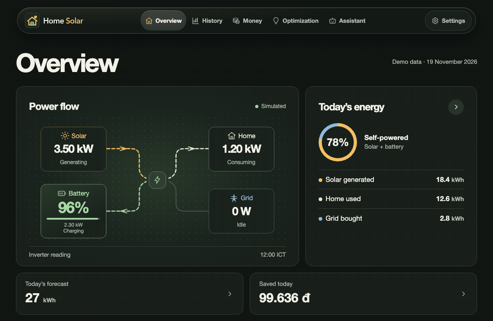
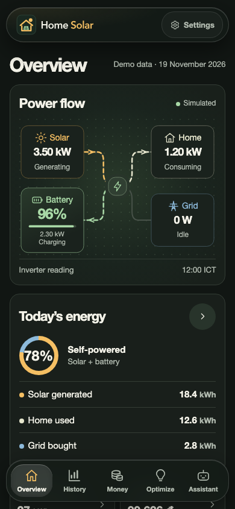
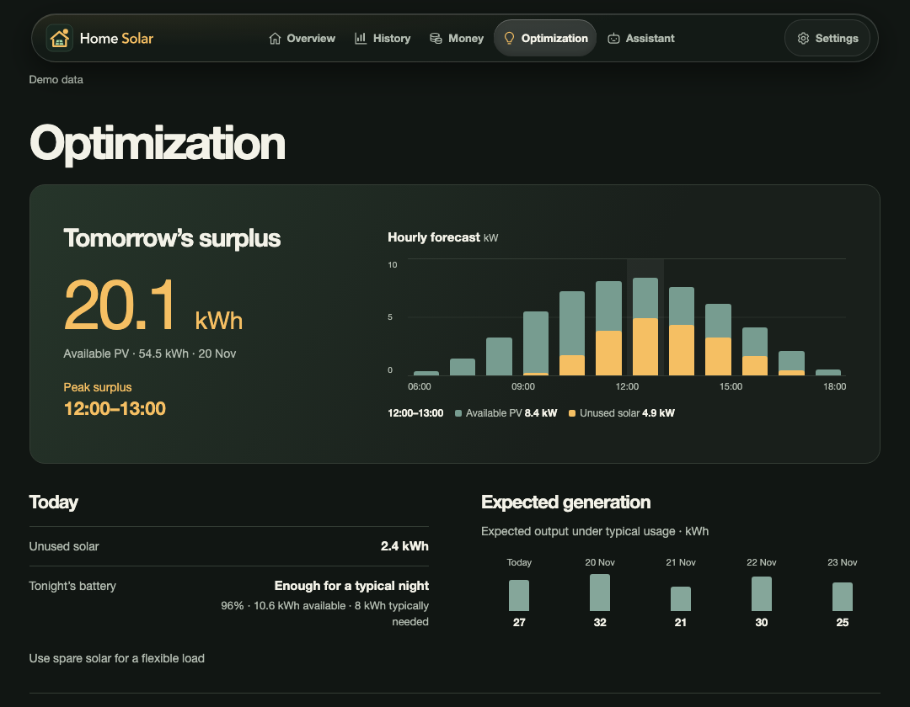

# Home Solar

A desktop and mobile dashboard for monitoring a hybrid GoodWe solar system. Follow power as it moves between the solar panels, home, battery, and grid. Review how much of your energy use was covered by solar and the battery, track EVN bills and estimated savings, and use the solar forecast to decide when to run appliances.

## Dashboard preview



The GIF and screenshots use the built-in demo data. Once the frontend is running, add `?demo=1` to the Overview, History, Money, or Optimization URL to explore these screens without a GoodWe or EVN account. [Open the local Overview demo](http://localhost:3001/?demo=1)

<details>
<summary>Mobile and Optimization screenshots</summary>





</details>

## Stack

The Next.js app lives in `frontend/solar-next`, with `frontend/solar-app` as the deployment entry point. FastAPI polls the inverter, stores readings in SQLite, and serves `/api/*` through the frontend's proxy.

- Next.js 16, React 19, JavaScript and CSS for the dashboard
- FastAPI and uvicorn for the API
- SQLite (`history.db`) for minute samples, daily totals, EVN bills, notices, and weather
- GoodWe SEMS+ for cloud live data and history
- Optional local Modbus reads through the `goodwe` package
- EVN residential tiered tariff, with VAT, for savings and the projected bill
- Optional yield forecast from Open-Meteo weather plus a walk-forward model (Ridge, or gradient boosting when scikit-learn is installed)
- Optional assistant: Gemini, or a local Ollama model, with function calls against the stored history

`source` in the config selects the live provider: `mock`, `cloud`, or `local`. `history_source` can point history reads at a different provider.

## Screens

| Route | What it shows |
|---|---|
| `/` | Live PV, home load, battery, and grid, plus today's energy split |
| `/history` | Daily generation, month and year totals, self-powered days |
| `/money` | Cycle savings, projected EVN bill, the last real bill, and the current tariff tier |
| `/optimization` | Tomorrow's hourly solar surplus forecast, tonight's battery outlook, estimated unused solar, and expected generation |
| `/settings` | Language, advanced readings, and device notifications |
| `/assistant` | Rule-based notices and a streaming chat that can look up history before answering |

Settings stores language and advanced readings in browser cookies. The Assistant keeps conversations on the current browser and can display and dismiss system notices.

## Run it

Use Python 3.12+ and Node 22+.

```bash
python3 -m venv .venv
source .venv/bin/activate
pip install fastapi uvicorn httpx goodwe

cd frontend/solar-app
npm ci
```

The yield forecast also needs `numpy`. Install `scikit-learn` as well if you want the gradient-boosting candidate in the model bake-off. Without `numpy`, the rest of the dashboard still runs and the forecast stays off.

Create `config.json` in the project root. Start with mock data, which needs no accounts:

```json
{
  "source": "mock",
  "history_source": "mock",
  "station_name": "Home Solar",
  "capacity_kw": 16.0,
  "price_per_kwh": 2500,
  "currency": "VND",
  "poll_interval_seconds": 5,
  "backfill_months": 18,
  "host": "127.0.0.1",
  "port": 8787
}
```

`config.json` and `history.db` are gitignored. Do not commit inverter passwords, portal logins, or API keys.

From the project root:

```bash
source .venv/bin/activate
python server.py
```

In another terminal:

```bash
cd frontend/solar-app
npm run dev
```

Open [http://localhost:3001](http://localhost:3001). The API listens on [http://127.0.0.1:8787](http://127.0.0.1:8787). Next.js rewrites `/api/*` to that process, with a 120 second proxy timeout so a long assistant reply is not cut off. Override the target with `BACKEND_URL` if the API is not on port 8787.

To open the dev server from another device, run `npx next dev --hostname 0.0.0.0 --port 3001` and configure the device's origin in `frontend/solar-next/next.config.mjs` if needed.

`debugs/backfill_loop.py` and `debugs/backfill_evn.py` run one sync pass by hand. The server already does this on startup, so they are only for a one-off check.

## Home Screen and iPhone notifications

After opening the HTTPS dashboard in Safari on iOS 16.4 or later, use **Share → Add to Home Screen**. Open the Home Solar icon, go to **Settings → Notifications**, enter the device setup code, and tap **Enable notifications**. Grant permission, then tap **Send test** and check the iPhone's notifications.

To enable Web Push on the server, use a real inverter provider and install the optional sender in the backend's Python environment. Generate the private key once from the project root:

```bash
pip install 'pywebpush>=2.1,<3'
(umask 077 && python - <<'PYKEY'
from py_vapid import Vapid

key = Vapid()
key.generate_keys()
with open(".env.solar-vapid.pem", "xb") as output:
    output.write(key.private_pem())
PYKEY
)
python -c 'import secrets; print(secrets.token_urlsafe(32))'
```

Add these settings to the server's private `.env` using your email and the generated setup code:

```dotenv
SOLAR_PUSH_PRIVATE_KEY_FILE=.env.solar-vapid.pem
SOLAR_PUSH_CONTACT=mailto:owner@example.com
SOLAR_PUSH_SETUP_CODE=<generated-device-setup-code>
```

Restart the backend and serve the Next.js app and its `/api/push/*` proxy at the same HTTPS origin that the iPhone uses. The backend needs outbound HTTPS access to Apple's `*.push.apple.com` endpoints. Keep the VAPID key across releases. Back up the key and `push.db` privately if moving the service. Changing the key or dashboard origin requires re-enrolling the iPhone.

The backend sends an alert once per low-battery episode and rearms at 22%. It also reports when 10 minutes elapse without any fresh data from the primary feed and when that feed recovers. The server must stay online with access to the push service to send alerts.

## What the API does in the background

While `server.py` is running:

- Polls the live provider on `poll_interval_seconds` (default 5).
- Syncs SEMS daily generation and usage, fills yesterday's and today's sample gaps, rebuilds curtailment, and prunes old minute samples. The first pass waits for login, then repeats every 12 hours. It re-reads only as far back as the oldest hole, and at least the last 2 months.
- Syncs the EVN customer portal when `evn.portal.enabled` is set, then every 12 hours.
- Trains the yield forecast after the first history sync, then every 12 hours. Training needs a site location from the live poll and at least 20 days of history.
- Checks notice rules every 15 minutes, after history has synced.

`POST /api/sync` starts the same history pass in the background. It returns 409 if one is already running and 429 if the last one finished less than 2 minutes ago.

## Cloud, local, EVN, and the assistant

`cloud` logs in to GoodWe SEMS+ and reads station flow, daily curves, and inverter energy counters. Put the account in `config.json` under `cloud.account` and `cloud.password`. `region` can be `auto`, `hk`, `eu`, `au`, `us`, or `cn`.

`local` reads a GoodWe inverter on the LAN through Modbus. Set `local.host` to the inverter address.

Leave `station_id` empty to use the first station on the account.

`evn` is optional. Omit it and the built-in residential tiers (plus 8% VAT) are used. `evn.cycle_start_day` is the day the billing cycle resets. `evn.portal` pulls real meter readings and bills when `enabled` is true and `customer_id`, `username`, and `password` are set. `base_url` defaults to the EVN HCMC customer portal.

`ai` is optional. Without it, Assistant shows notices and reports that chat is off.

```json
{
  "ai": {
    "provider": "gemini",
    "model": "gemini-flash-lite-latest",
    "api_key": "..."
  }
}
```

`provider` can be `gemini` (needs `api_key`) or `ollama` (local, default `http://127.0.0.1:11434`). Gemini can call tools for a day, daily history, the billing cycle, curtailment, the weather forecast, and the hourly profile.

## Tests

```bash
source .venv/bin/activate
python -m unittest discover -s tests
```


## Dated EVN tariffs and forecast diagnostics (November 2026)

The built-in residential schedule retains the legacy six-tier prices and applies the five-tier schedule from **2026-11-01**: 100/200/400/700/open-ended kWh at 1,901/2,289/2,894/3,456/3,844 VND before VAT. Sources: [EVN price publication](https://www.evn.com.vn/d/vi-VN/news/Gia-ban-le-dien-cho-cac-nhom-khach-hang-su-dung-dien-theo-Quyet-dinh-so-2892QD-BCT-ngay-31102026-cua-Bo-Cong-Thuong-60-28-510170) and [EVNSPC tariff information](https://cskh.evnspc.vn/TraCuu/ThongTinGiaDien). VAT remains the configured rate (8% default); future projections hold that assumption fixed, rather than predicting future policy.

Existing configurations whose tiers match the old EVN schedule automatically receive this dated schedule. Other custom tier tables stay custom. Explicit `evn.schedules` entries may define `effective_from`, `tiers`, `vat` and `label` for future changes. Historical monthly savings and real-bill comparisons select their own period's schedule. A cycle spanning a change date uses estimated allocation by days, prorating both volume and tier quotas; it is labeled approximate because the change-date EVN meter reading is unavailable. Actual EVN bills remain the source of truth.

Optimization prices use projected billing-cycle purchases rather than trailing-30-day purchases. A hypothetical displaced grid quantity is valued with a difference between tiered bills, capped at projected purchases. Curtailment is shown primarily in kWh; its tariff equivalent is not cash lost or a promise of recoverable savings. Residential grid prices are not time-of-day prices. All site clocks, battery finish times and best-hour markers use Vietnam time regardless of browser timezone.

The legacy accuracy view shows model-selection backtests. Its former URL now opens Optimization, where advanced readings include forecast diagnostics. Archived weather differs from the forecasts available at issue time. Chart and error metrics use the same raw predictions; serving still clips forecasts as before. Read the [37-day data-quality experiment and gate decision](docs/forecast-diagnostic-2026-11-08.md) before pursuing a potential/usable production model. Production training/selection is unchanged.

Verification:

```bash
.venv/bin/python -m unittest discover -s tests
TZ=America/Los_Angeles node --test frontend/solar-app-legacy/tests/site-time.test.mjs
cd frontend/solar-app
npm run build
```
